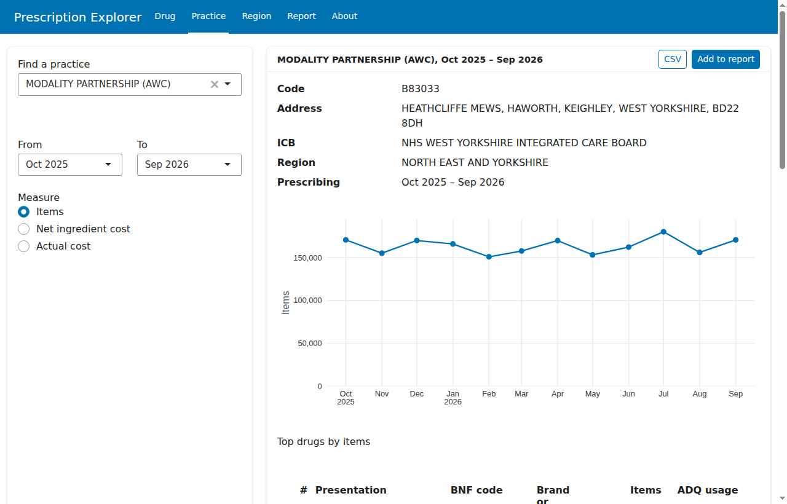

# Prescription Explorer

[](https://github.com/katonometrica/prexp/actions/workflows/ci.yaml)
[](.github/workflows/ci.yaml)


[](LICENSE.md)

A case study in spec-driven development with a coding agent. The developer wrote the project plan, the architecture included, and settled its open questions. From that plan, [Claude Code](https://claude.com/claude-code), Anthropic's coding agent, wrote the specification and the 55 issues, and the developer approved both before any code. The agent then wrote the code, with each issue's tasks and "done when" checks as its brief, and stopped after each of Phases 0 to 5 for the developer's go-ahead.

That split is the point. The developer decides what is built and what counts as done: the plan, the approval of the specification and the issues, and the go-ahead at each phase's end. The agent writes the specification's text and the code, and edits both as it goes. CI gates the changes, and review agents check most of them.

The test bed is real: an app over NHSBSA's prescribing data for England, about 18 million rows a month for twelve months, that looks up a drug or a practice, compares a drug across regions, and exports a report to PowerPoint, Word or Excel. It is live at **[prexp.katonometrica.com](https://prexp.katonometrica.com/)**, with [screenshots below](#the-test-bed). Built by [Katonométrica](https://katonometrica.com).

## The method

1. **The plan, then the specification.** The developer's plan, which is not in the repository, set the goal, the architecture and the phases. [docs/spec.md](docs/spec.md), written from it, sets what the app must answer, its data model, queries, tests and deployment, and five measurable targets. It was committed in the first pull request, [#56](https://github.com/katonometrica/prexp/pull/56), before any code.
2. **Then the issues, with "done when" checks.** 55 issues in [nine milestones](https://github.com/katonometrica/prexp/milestones?state=all), created between 08:24 and 08:28 UTC on 23 November, before the first pull request opened at 08:36. Each gives its estimate, dependencies, tasks and checks, as [P3-01](https://github.com/katonometrica/prexp/issues/23) does, and all but three documentation issues ([#22](https://github.com/katonometrica/prexp/issues/22), [#47](https://github.com/katonometrica/prexp/issues/47), [#48](https://github.com/katonometrica/prexp/issues/48)) name the specification sections they implement.
3. **A branch and a pull request for each change, each naming its issue.** [Every merged pull request](https://github.com/katonometrica/prexp/pulls?q=is%3Apr+is%3Amerged)'s description opens with the issue it closes or refers to. [The spec](https://github.com/katonometrica/prexp/blob/25cd2f41fc3b8140677da31ff8ee74009ef8d10a/docs/spec.md?plain=1#L415) asks for one per issue; 38 issues took one and 13 took two to six, so 74 pull requests served 51 issues. From the loader in Phase 1 on, review agents checked most of them before the merge: finders, then a verifier that tries to refute each finding ([#88](https://github.com/katonometrica/prexp/pull/88)).
4. **CI gates every merge:** lint, migrations, tests on PostgreSQL 18 with two coverage gates, and, since [#113](https://github.com/katonometrica/prexp/pull/113), browser flows ([ci.yaml](.github/workflows/ci.yaml)). `main` takes only a squash-merged pull request whose `test` check passed, and no one can bypass that ([the ruleset](.github/rulesets/protect-main.json)). It asks for no approval, by design ([P0-01](https://github.com/katonometrica/prexp/issues/1)): the person reviews each phase, not each pull request. Only the first commit, pushed before `main` was protected, and the five pull requests before CI arrived in [#61](https://github.com/katonometrica/prexp/pull/61) came in without CI.
5. **A stop at each phase's end,** where the developer decides what comes next. The stops are in the session record, not the repository. At Phase 0's end, review agents also went over the whole phase and their findings were fixed ([#66](https://github.com/katonometrica/prexp/pull/66), [#67](https://github.com/katonometrica/prexp/pull/67)), and the plan changed: the server would come late ([#69](https://github.com/katonometrica/prexp/pull/69)).

## How it went

From the record, up to pull request #134 on 26 November 2026:

- **The specification and the plan were edited, not frozen.** [39 of the 73](https://github.com/katonometrica/prexp/commits/25cd2f41fc3b8140677da31ff8ee74009ef8d10a/docs/spec.md) pull requests after #56 changed the spec, 36 of them along with code, tests or infrastructure. It [grew from 5,872 to 10,308 words](docs/case-study.md#the-specification-during-the-build), but kept all 28 headings, and four of its five targets word for word. 29 of the 55 issues had tasks or checks rewritten too, most of them on the first day, with the dataset check's findings ([#64](https://github.com/katonometrica/prexp/pull/64)) and the change of plan ([#69](https://github.com/katonometrica/prexp/pull/69)); only two estimates changed ([detail](docs/case-study.md#estimates-against-time)).
- **The code still drifted from the spec.** Two targets met on the development machine are missed on the production server: lookups take 540 ms at the 95th percentile, network included, against 300 ms ([#44](https://github.com/katonometrica/prexp/issues/44) is open), and two of the 25 query checks take 52 to 58 ms against 50, so the nightly check there allows 150 ([#119](https://github.com/katonometrica/prexp/pull/119)). The spec also still lags the code in [five places](docs/case-study.md#where-the-spec-lagged-the-code), such as a package layout that names two files the code no longer has.
- **Review agents found what the tests missed.** They confirmed [at least 275 findings](docs/case-study.md#what-the-reviews-caught), as the pull requests' descriptions count them: 18 of them in Phase 0's review of merged work, 2 after their change had merged, and at least 255 before a merge. Among them: a cancelled CI run that GitHub would count as a passed check ([#66](https://github.com/katonometrica/prexp/pull/66)), a refused month that still changed the live data ([#78](https://github.com/katonometrica/prexp/pull/78)), and a link of about 300 characters that could crash every session at once ([#104](https://github.com/katonometrica/prexp/pull/104)).
- **What the person in the loop caught came from watching the work and using the app,** not from the stops at the phases' ends. After a pick, the search box took no typing: a review had flagged it, and the agent had only worked round it with a clear button ([#96](https://github.com/katonometrica/prexp/pull/96), [#115](https://github.com/katonometrica/prexp/issues/115); [the developer's other catches](docs/case-study.md#the-developers-catches)). The load test the spec planned found the other bug that became an issue ([#101](https://github.com/katonometrica/prexp/issues/101)). And the three checks only a person could make, that each export opens in PowerPoint, Word and Excel, were still unticked when their issues closed on merge ([#39](https://github.com/katonometrica/prexp/issues/39), [#40](https://github.com/katonometrica/prexp/issues/40), [#41](https://github.com/katonometrica/prexp/issues/41)).
- **Estimates against elapsed time.** The plan priced v1 at [179 hours](docs/spec.md#9-work-breakdown), 22 working days for one person. Phases 0 to 5, 152 of those hours, ran [44 calendar hours](docs/case-study.md#estimates-against-time), two nights included, from the first commit to the last merge, and [46 of v1's 48 issues](https://github.com/katonometrica/prexp/milestones?state=all) had closed within 81 hours of the first commit. That is elapsed time, not effort: the developer's hours were not measured, and the planning before the first commit is not counted.
- **Where the agent failed.** [#101](https://github.com/katonometrica/prexp/issues/101): for the chemical with the most presentations, the Drug view took 864 ms at the 95th percentile against the 300 ms target. The spec asked for worst cases in the query checks but not in building a view, and the agent had checked the view by hand on atorvastatin ([#97](https://github.com/katonometrica/prexp/pull/97)). [#115](https://github.com/katonometrica/prexp/issues/115): after a pick, typing in the search box did nothing; the spec described only a first search. Neither fix went back into the spec at the time: #101's lesson reached it 37 hours later, once the server had missed the target too ([#125](https://github.com/katonometrica/prexp/pull/125)), and #115's only as one of the browser flows the spec lists for CI ([#133](https://github.com/katonometrica/prexp/pull/133)). Nothing in the method asked for it: [§8](docs/spec.md#8-repository-conventions) makes tests ship with the code, and says nothing of the spec.

The detail, with the source of each figure, public or from the session record: [docs/case-study.md](docs/case-study.md).

## One requirement, end to end

The app must never run with a login that can write. The links to files are pinned to a commit.

1. **Specification:** [§5.4](https://github.com/katonometrica/prexp/blob/25cd2f41fc3b8140677da31ff8ee74009ef8d10a/docs/spec.md?plain=1#L333): the app's connections are read-only by the server's settings, not by the client's request, or the app refuses to start.
2. **Issue:** [#23, P3-01](https://github.com/katonometrica/prexp/issues/23): a startup safety check, and a test that "a writable role is refused".
3. **Pull request:** [#88](https://github.com/katonometrica/prexp/pull/88), squashed as [601a372](https://github.com/katonometrica/prexp/commit/601a372f2aeb472b659f85213ee4faf7f74f0146). Its first version [passed CI](https://github.com/katonometrica/prexp/actions/runs/45392800770), yet its review got round the check with `PGOPTIONS`; the fix and the spec's new wording came in the same commit. A verifier's note after the merge led to [#90](https://github.com/katonometrica/prexp/pull/90), ten minutes later: the check now tests the login, not the role it acts as.
4. **Code:** [`check_read_only()`](https://github.com/katonometrica/prexp/blob/25cd2f41fc3b8140677da31ff8ee74009ef8d10a/R/db.R#L162-L196), run on every connection the app and its workers open.
5. **Test:** ["the app refuses a login that can write, even one the client made read-only"](https://github.com/katonometrica/prexp/blob/25cd2f41fc3b8140677da31ff8ee74009ef8d10a/tests/testthat/test-db.R#L77-L119).
6. **CI gate:** the `checks` job runs it on PostgreSQL 18 with the real role scripts, and fails rather than skips without a database ([ci.yaml L163–L211](https://github.com/katonometrica/prexp/blob/25cd2f41fc3b8140677da31ff8ee74009ef8d10a/.github/workflows/ci.yaml#L163-L211)), in its "Test with coverage" step ([L226–L243](https://github.com/katonometrica/prexp/blob/25cd2f41fc3b8140677da31ff8ee74009ef8d10a/.github/workflows/ci.yaml#L226-L243)). The required check, [`test`](https://github.com/katonometrica/prexp/blob/25cd2f41fc3b8140677da31ff8ee74009ef8d10a/.github/workflows/ci.yaml#L284-L302), passes only if `checks` did.
7. **Production:** [`run_app()`](https://github.com/katonometrica/prexp/blob/25cd2f41fc3b8140677da31ff8ee74009ef8d10a/R/run_app.R#L32-L35) opens the pool as the app starts, so the app does not start with such a login.

What CI fails on if any step of this chain is removed, and the one gap it leaves: [docs/case-study.md](docs/case-study.md#one-requirement-end-to-end).

## The test bed

Every month the NHS Business Services Authority (NHSBSA) publishes the prescriptions that NHS primary care prescribers in England issued and that were dispensed in the community: one CSV of about 18 million rows, 7.7 GB. Prescription Explorer keeps the latest twelve months in PostgreSQL: look up a drug or a practice, compare a drug across England's regions, pin what you find to a report with notes, and export it to PowerPoint, Word or Excel. It is a Shiny app built as an R package, in production on a small shared server, 4 CPUs and 15 GB of memory, where a scheduled task loads each new month.


| A drug and its presentations | A practice | A report, ready to export |
| --- | --- | --- |
|  |  |  |

## Five techniques, and where they are

- **Query plans checked, not assumed.** Every query's plan is checked on the full twelve months, and nightly in production: a fact-table read that is not index-only, a partition not pruned, a heap fetch or a slow query fails it. [R/fct_plan_check.R](R/fct_plan_check.R), [tests/testthat/test-plan-check.R](tests/testthat/test-plan-check.R)
- **A month loaded whole or not at all.** Before a month goes live, the loader checks its new table against staging: every staged value valid, the row counts, and the totals of items and of both costs. Any mismatch stops the load with the live data untouched, and the swap is one transaction. [inst/sql/load/](inst/sql/load/), [R/fct_loader.R](R/fct_loader.R), [tests/testthat/test-loader.R](tests/testthat/test-loader.R)
- **Tests on a database the real loader builds** from real rows, checked against totals computed independently from the fixture files, and browser flows with shinytest2. [tests/testthat/helper-oracle.R](tests/testthat/helper-oracle.R), [tests/testthat/e2e-flows.R](tests/testthat/e2e-flows.R)
- **A cache shared by every session that never shares an error.** It wraps the fetch functions instead of using `bindCache()`, so one session's passing database error is never served to the others. [R/fct_cache.R](R/fct_cache.R)
- **Speed measured as users meet it.** Lookups are timed at the 95th percentile with five users replaying recorded sessions, on the development machine and on the server; exports run on two `mirai` workers, off the app's process. [bench/](bench/), [docs/benchmarks.md](docs/benchmarks.md), [R/fct_workers.R](R/fct_workers.R)

Every technique, with the files that show it: [docs/architecture.md](docs/architecture.md#techniques-and-where-they-are).

## How it fits together


[docs/architecture.md](docs/architecture.md) gives each decision and what it costs.

## Try it in one command

With Docker, from a clone of this repository (`git clone https://github.com/katonometrica/prexp`):

```sh
docker compose -f compose.demo.yaml up
```

The first run downloads about 0.75 GB of images. The real loader then loads a sample into PostgreSQL 18, which takes about 20 seconds; once the app's log says it is listening, open <http://localhost:3838>. There is nothing to install or configure.

- **The sample is test data, not statistics:** every row of eight real prescribers, and a sample of the prescribing NHSBSA could not attribute to a prescriber, from September 2026, plus twelve earlier months made from them with every figure scaled (the test fixtures).
- **The app's image is built for x86-64 only.** Docker Desktop on an Apple Silicon Mac runs it under emulation; on an Arm Linux machine, Docker needs amd64 emulation installed first.
- **The demo's database asks for no password** and publishes no port. With Docker Engine on Linux, though, any user of the machine can reach it while the demo runs: use a machine you do not share.
- **`docker compose -f compose.demo.yaml down -v`** removes the containers and the data. The downloaded images stay; `--rmi all` removes them too, the PostgreSQL image included, which the development stack also uses.

## Documents

- [docs/case-study.md](docs/case-study.md): how the method went, from the record: the specification's changes, what the reviews caught, estimates against time, where the agent failed, and one requirement traced end to end.
- [docs/architecture.md](docs/architecture.md): each design decision and what it costs, and every technique with its files.
- [docs/spec.md](docs/spec.md): the specification the issues were written from: the data model, the queries, the tests, deployment, the work breakdown and the plans for v2.
- [docs/benchmarks.md](docs/benchmarks.md): the measurements, with how each was made.
- [docs/dataset.md](docs/dataset.md): what the loader relies on about NHSBSA's files.
- [docs/development.md](docs/development.md): the development stack, R packages, the tests and the full twelve months.
- [docs/server.md](docs/server.md) and [docs/runbook.md](docs/runbook.md): the production server, set up and operated.
- [NEWS.md](NEWS.md): what each release contains.

## Data

[English Prescribing Dataset (EPD) with SNOMED Code](https://opendata.nhsbsa.net/dataset/english-prescribing-dataset-epd-with-snomed-code), published by the NHS Business Services Authority. NHSBSA Copyright 2021-2026. Contains public sector information licensed under the [Open Government Licence v3.0](https://www.nationalarchives.gov.uk/doc/open-government-licence/version/3/).

The data has limits: it counts prescription items and quantities, not patients or diagnoses, and about a third of items have no ADQ (average daily quantity) defined, every insulin and oral anticoagulant among them, so their ADQ usage is blank. [docs/dataset.md](docs/dataset.md) has the details.

## Licence

Code: MIT, copyright [Katonométrica](https://katonometrica.com); see [LICENSE.md](LICENSE.md). Data: Open Government Licence v3.0.

The IBM Plex fonts bundled with the app are under the SIL Open Font License 1.1 ([inst/app/www/fonts/OFL.txt](inst/app/www/fonts/OFL.txt)). The KATONOMETRICA name and mark are not covered by the MIT licence.
