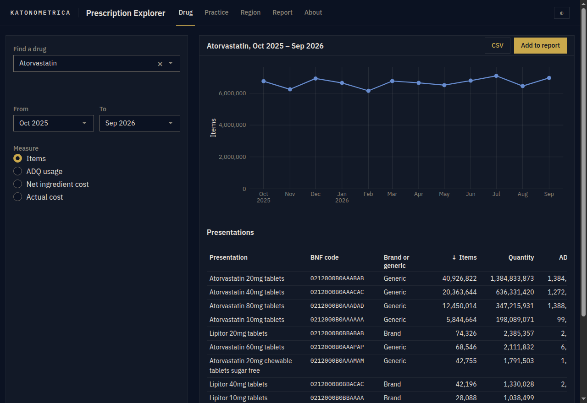

# Prescription Explorer

[](https://github.com/katonometrica/prexp/actions/workflows/ci.yaml)
[](.github/workflows/ci.yaml)


[](LICENSE.md)

A reference case of spec-driven development with a coding agent. The developer wrote the specification and the plan, and the work stopped at the end of each phase for the developer's review. [Claude Code](https://claude.com/claude-code), Anthropic's coding agent, wrote the code, one issue at a time. Every change went through a pull request and CI, except the first six, made before CI existed.

That split is the point. The developer owns what is built and when it is done: the specification, the plan and the reviews. The agent writes the code, quickly, and the method checks its work at every step.

The test bed is real: NHSBSA's monthly prescribing data, about 18 million rows a month, kept for twelve months, in an app that is live at **[prexp.katonometrica.com](https://prexp.katonometrica.com/)**. Built by [Katonométrica](https://katonometrica.com).

## The method

1. **The specification first.** [docs/spec.md](docs/spec.md) sets what the app must answer, its architecture, data model, queries, tests and deployment, and five measurable targets. It came with the repository, in [#56](https://github.com/katonometrica/prexp/pull/56).
2. **Then the plan, as issues with "done when" checks.** 55 issues in [nine milestones](https://github.com/katonometrica/prexp/milestones?state=all), all created before the first pull request. Each gives its estimate, dependencies, tasks and checks, and all but three documentation issues ([#22](https://github.com/katonometrica/prexp/issues/22), [#47](https://github.com/katonometrica/prexp/issues/47), [#48](https://github.com/katonometrica/prexp/issues/48)) the specification sections they implement, as [P3-01](https://github.com/katonometrica/prexp/issues/23) does.
3. **One branch and one pull request per issue.** Each names its issue on its first line, as [every merged one](https://github.com/katonometrica/prexp/pulls?q=is%3Apr+is%3Amerged) does. From the loader in Phase 1 on, review agents checked most of them before the merge: finders, then a verifier that tries to refute each finding ([#88](https://github.com/katonometrica/prexp/pull/88)).
4. **CI gates every merge:** lint, migrations, tests on PostgreSQL 18 with two coverage gates, and browser flows ([ci.yaml](.github/workflows/ci.yaml)). `main` takes only a squash-merged pull request whose `test` check passed, with no exceptions ([the ruleset](.github/rulesets/protect-main.json)). Only the first commit, pushed before `main` was protected, and the five pull requests before CI arrived in [#61](https://github.com/katonometrica/prexp/pull/61) came in without it.
5. **A review at each phase's end,** where the developer decides what comes next. Phase 0's included a review of the whole phase ([#66](https://github.com/katonometrica/prexp/pull/66), [#67](https://github.com/katonometrica/prexp/pull/67)) and changed the plan: the server would come late ([#69](https://github.com/katonometrica/prexp/pull/69)).

## How it went

From the record, up to pull request #134 on 26 November 2026:

- **The specification was edited, not frozen.** [39 of the 73](https://github.com/katonometrica/prexp/commits/main/docs/spec.md) pull requests after it changed it, 36 of them along with code, tests or infrastructure. It [grew from 5,872 to 10,308 words](docs/case-study.md#the-specification-during-the-build), but all 28 headings and four of its five targets stand as first written.
- **What the reviews caught.** Review agents confirmed [at least 275 findings](docs/case-study.md#what-the-reviews-caught) before merge, such as a refused month that still changed the live data ([#78](https://github.com/katonometrica/prexp/pull/78)) and a 300-character link that could crash every session at once ([#104](https://github.com/katonometrica/prexp/pull/104)). The two bugs that got past them were found by the planned load test and by using the app.
- **Estimates against time.** The plan priced v1 at [179 hours](docs/spec.md#9-work-breakdown), paced for a person at 22 working days. Phases 0 to 5, 152 of those hours, took [44 calendar hours](docs/case-study.md#estimates-against-time) from first commit to last merge; [46 of v1's 48 issues](https://github.com/katonometrica/prexp/milestones?state=all) closed within 81 hours.
- **Where the agent failed.** [#101](https://github.com/katonometrica/prexp/issues/101): the Drug view took 864 ms at the 95th percentile for the largest chemical, against 300 ms; the spec asked for worst cases in the query checks, not in building a view. [#115](https://github.com/katonometrica/prexp/issues/115): typing over a picked drug did nothing, though a review had flagged it the day before. Neither fix changed the spec at the time.

The detail, with the source of every figure: [docs/case-study.md](docs/case-study.md).

## One requirement, end to end

The app must never run with a login that can write. The links to files are pinned to a commit.

1. **Specification:** [§5.4](https://github.com/katonometrica/prexp/blob/25cd2f41fc3b8140677da31ff8ee74009ef8d10a/docs/spec.md?plain=1#L333): the app's connections are read-only by the server's settings, not by the client's request, or the app refuses to start.
2. **Issue:** [#23, P3-01](https://github.com/katonometrica/prexp/issues/23): a startup safety check, and a test that "a writable role is refused".
3. **Pull request:** [#88](https://github.com/katonometrica/prexp/pull/88), squashed as [601a372](https://github.com/katonometrica/prexp/commit/601a372f2aeb472b659f85213ee4faf7f74f0146). Its first version [passed CI](https://github.com/katonometrica/prexp/actions/runs/45392800770), yet its review got round the check with `PGOPTIONS`; the fix and the spec's new wording came in the same commit.
4. **Code:** [`check_read_only()`](https://github.com/katonometrica/prexp/blob/25cd2f41fc3b8140677da31ff8ee74009ef8d10a/R/db.R#L162-L196), run on every connection the app and its workers open.
5. **Test:** ["the app refuses a login that can write, even one the client made read-only"](https://github.com/katonometrica/prexp/blob/25cd2f41fc3b8140677da31ff8ee74009ef8d10a/tests/testthat/test-db.R#L77-L119).
6. **CI gate:** the `checks` job runs it on PostgreSQL 18 with the real role scripts, and fails rather than skips without a database ([ci.yaml](https://github.com/katonometrica/prexp/blob/25cd2f41fc3b8140677da31ff8ee74009ef8d10a/.github/workflows/ci.yaml#L163-L211)). The required check, [`test`](https://github.com/katonometrica/prexp/blob/25cd2f41fc3b8140677da31ff8ee74009ef8d10a/.github/workflows/ci.yaml#L284-L302), passes only if `checks` did.
7. **Production:** [`run_app()`](https://github.com/katonometrica/prexp/blob/25cd2f41fc3b8140677da31ff8ee74009ef8d10a/R/run_app.R#L32-L35) opens the pool as the app starts, so the app does not start with such a login.

What fails if a link is broken: [docs/case-study.md](docs/case-study.md#one-requirement-end-to-end).

## The test bed

Every month the NHS Business Services Authority (NHSBSA) publishes the prescriptions that NHS primary care prescribers in England issued and that were dispensed in the community: one CSV of about 18 million rows, 7.7 GB. Prescription Explorer keeps the latest twelve months in PostgreSQL: look up a drug or a practice, compare a drug across England's regions, pin what you find to a report with notes, and export it to PowerPoint, Word or Excel. It is a Shiny app built as an R package, in production on a small shared server, 4 CPUs and 15 GB of memory, where a scheduled task loads each new month.


| A drug and its presentations | A practice | A report, ready to export |
| --- | --- | --- |
|  |  |  |

## What sets the engineering apart

- **Query plans checked, not assumed.** Every query's plan is checked on the full twelve months, and nightly in production: a fact-table read that is not index-only, a partition not pruned, a heap fetch or a slow query fails it. [R/fct_plan_check.R](R/fct_plan_check.R), [tests/testthat/test-plan-check.R](tests/testthat/test-plan-check.R)
- **A read-only login, checked on the server's side.** The app stops if its login can write, is a superuser, or can use the loader's schemas. [R/db.R](R/db.R) (`check_read_only()`), [tests/testthat/test-db.R](tests/testthat/test-db.R)
- **Tests on a database the real loader builds** from real rows, checked against totals computed independently from the fixture files, and browser flows with shinytest2. [tests/testthat/helper-oracle.R](tests/testthat/helper-oracle.R), [tests/testthat/e2e-flows.R](tests/testthat/e2e-flows.R)
- **A cache shared by every session that never shares an error.** It wraps the fetch functions instead of using `bindCache()`, so one session's passing database error is never served to the others. [R/fct_cache.R](R/fct_cache.R)
- **Exports off the app's process, and speed measured as users meet it.** Exports run on two `mirai` workers as `ExtendedTask`s. Lookups are timed at the 95th percentile with five users replaying recorded sessions, on the development machine and on the server. [R/fct_workers.R](R/fct_workers.R), [bench/](bench/), [docs/benchmarks.md](docs/benchmarks.md)

Every technique, with the files that show it: [docs/architecture.md](docs/architecture.md#techniques-and-where-they-are).

## How it fits together


[docs/architecture.md](docs/architecture.md) gives each decision and what it costs.

## Try it in one command

With Docker, from a clone of this repository (`git clone https://github.com/katonometrica/prexp`):

```sh
docker compose -f compose.demo.yaml up
```

The first run downloads about 0.75 GB of images. The real loader then loads a sample into PostgreSQL 18, which takes about 20 seconds; once the app's log says it is listening, open <http://localhost:3838>. There is nothing to install or configure.

- **The sample is test data, not statistics:** every row of eight real prescribers, and a sample of the prescribing NHSBSA could not attribute to a prescriber, from September 2026, plus twelve earlier months made from them with every figure scaled (the test fixtures).
- **The app's image is built for x86-64 only.** Docker Desktop on an Apple Silicon Mac runs it under emulation; on an Arm Linux machine, Docker needs amd64 emulation installed first.
- **The demo's database asks for no password** and publishes no port. With Docker Engine on Linux, though, any user of the machine can reach it while the demo runs: use a machine you do not share.
- **`docker compose -f compose.demo.yaml down -v`** removes the containers and the data. The downloaded images stay; `--rmi all` removes them too, the PostgreSQL image included, which the development stack also uses.

## Documents

- [docs/case-study.md](docs/case-study.md): how the method went, from the record: the specification's changes, what the reviews caught, estimates against time, where the agent failed, and one requirement traced end to end.
- [docs/architecture.md](docs/architecture.md): each design decision and what it costs, and every technique with its files.
- [docs/spec.md](docs/spec.md): the specification the issues were written from: the data model, the queries, the tests, deployment, the work breakdown and the plans for v2.
- [docs/benchmarks.md](docs/benchmarks.md): the measurements, with how each was made.
- [docs/dataset.md](docs/dataset.md): what the loader relies on about NHSBSA's files.
- [docs/development.md](docs/development.md): the development stack, R packages, the tests and the full twelve months.
- [docs/server.md](docs/server.md) and [docs/runbook.md](docs/runbook.md): the production server, set up and operated.
- [NEWS.md](NEWS.md): what each release contains.

## Data

[English Prescribing Dataset (EPD) with SNOMED Code](https://opendata.nhsbsa.net/dataset/english-prescribing-dataset-epd-with-snomed-code), published by the NHS Business Services Authority. NHSBSA Copyright 2021-2026. Contains public sector information licensed under the [Open Government Licence v3.0](https://www.nationalarchives.gov.uk/doc/open-government-licence/version/3/).

The data has limits: it counts prescription items and quantities, not patients or diagnoses, and about a third of items have no ADQ (average daily quantity) defined, every insulin and oral anticoagulant among them, so their ADQ usage is blank. [docs/dataset.md](docs/dataset.md) has the details.

## Licence

Code: MIT, copyright [Katonométrica](https://katonometrica.com); see [LICENSE.md](LICENSE.md). Data: Open Government Licence v3.0.

The IBM Plex fonts bundled with the app are under the SIL Open Font License 1.1 ([inst/app/www/fonts/OFL.txt](inst/app/www/fonts/OFL.txt)). The KATONOMETRICA name and mark are not covered by the MIT licence.
