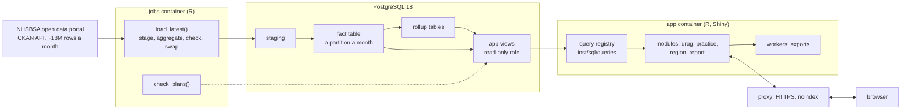

# Prescription Explorer

[](https://github.com/katonometrica/prexp/actions/workflows/ci.yaml)


[](LICENSE.md)

A Shiny app, built as an R package, over a rolling twelve months of the English Prescribing Dataset (EPD): the prescriptions issued in England and dispensed in the community, about 18 million rows a month, published by the NHS Business Services Authority. Look up a drug, a practice or a region, pin what you find to a report with notes, and export it to PowerPoint, Word or Excel.

It runs in production on a small shared server, 4 CPUs and 15 GB of memory, and loads each new month by itself. Its code is meant to be read: [What this demonstrates](#what-this-demonstrates) maps each technique to the files that show it.


## Try it in one command

With Docker, from a clone of this repository:

```sh
docker compose -f compose.demo.yaml up
```

Then open <http://localhost:3838>. This starts PostgreSQL 18, loads a sample with the real loader (the test fixtures: every row of eight real practices, from one month, repeated as thirteen months), and runs the app from its published image. There is nothing to install or configure. `docker compose -f compose.demo.yaml down -v` removes it all.

## What this demonstrates

| Technique | Where |
| --- | --- |
| A Shiny app as an R package: modules (`mod_*`) for the views, plain functions (`fct_*`, `utils_*`) for the logic | [R/](R/) |
| SQL kept in files: numbered, checksummed migrations, and one file per query | [inst/sql/](inst/sql/), [R/db.R](R/db.R) |
| A query registry: the app and the plan checks run the same SQL files, with parameters, never with values pasted in | [R/fct_query_registry.R](R/fct_query_registry.R), [R/fct_queries.R](R/fct_queries.R) |
| ETL from NHSBSA's CKAN API: download, stage, aggregate beside the live data, check, and swap a month in one transaction | [R/fct_source.R](R/fct_source.R), [R/fct_loader.R](R/fct_loader.R), [inst/sql/load/](inst/sql/load/) |
| Monthly partitions, covering indexes and rollup tables, so a lookup reads index entries and pre-aggregated rows, never a month's 18 million source rows | [inst/sql/migrations/](inst/sql/migrations/) |
| Each query's plan checked: index-only reads, partitions pruned, and its time, in the tests and nightly in production | [R/fct_plan_check.R](R/fct_plan_check.R) |
| A cache shared by every session, a connection pool, and background workers for the exports | [R/fct_cache.R](R/fct_cache.R), [R/db.R](R/db.R), [R/fct_workers.R](R/fct_workers.R) |
| Tests on a database the real loader builds from real rows, checked against totals computed independently; browser flows with shinytest2 | [tests/testthat/](tests/testthat/) |
| CI: a build image keyed to `renv.lock`, lint, migrations, tests, an 85% coverage gate and the browser flows; actions pinned to commit SHAs | [.github/workflows/ci.yaml](.github/workflows/ci.yaml) |
| Performance measured, not claimed: load times, query plans and p95 latency under load, on a laptop and on the server | [docs/benchmarks.md](docs/benchmarks.md) |
| Production on one server under Coolify: a scheduled monthly load, a nightly check, alerts, and deploys from CI | [docs/server.md](docs/server.md), [docs/runbook.md](docs/runbook.md) |
| The data's attribution on every page and in every export | [R/fct_methods.R](R/fct_methods.R) |

## How it fits together



[docs/architecture.md](docs/architecture.md) gives each decision and its trade-off.

| The Practice view | A drug across the regions | A report, ready to export |
| --- | --- | --- |
|  |  |  |

## Documents

- [docs/development.md](docs/development.md): the development stack, R packages, the tests and the full twelve months.
- [docs/spec.md](docs/spec.md): the design, from the data model to deployment.
- [docs/dataset.md](docs/dataset.md): what the loader relies on about NHSBSA's files.
- [docs/benchmarks.md](docs/benchmarks.md): every measurement, with how it was made.
- [docs/server.md](docs/server.md) and [docs/runbook.md](docs/runbook.md): the production server, set up and operated.
- [NEWS.md](NEWS.md): what each release contains.

## Data

[English Prescribing Dataset (EPD) with SNOMED Code](https://opendata.nhsbsa.net/dataset/english-prescribing-dataset-epd-with-snomed-code), published by the NHS Business Services Authority under the [Open Government Licence v3.0](https://www.nationalarchives.gov.uk/doc/open-government-licence/version/3/).

NHSBSA Copyright 2021-2026

Contains public sector information licensed under the Open Government Licence v3.0.

The data has limits the app keeps in view: it counts prescription items and quantities, not patients or diagnoses, and ADQ usage is zero for some drugs, insulins among them; [docs/dataset.md](docs/dataset.md) has the details.

## Licence

Code: MIT, copyright Katonométrica; see [LICENSE.md](LICENSE.md). Data: Open Government Licence v3.0.
