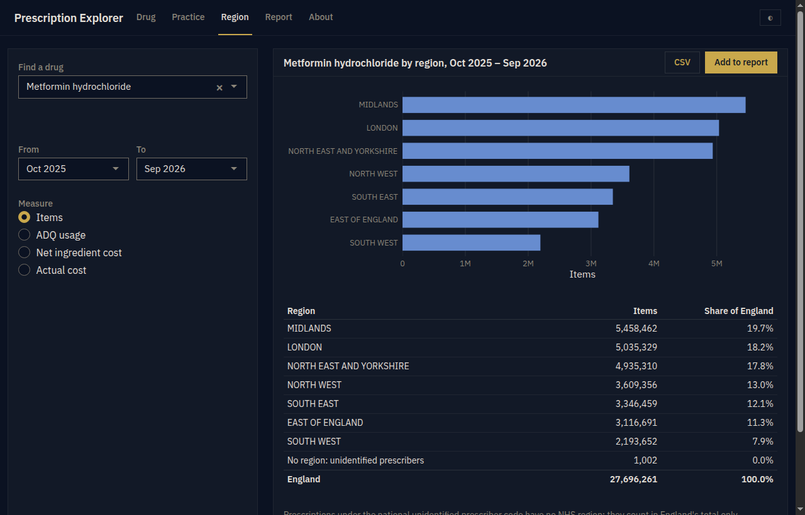
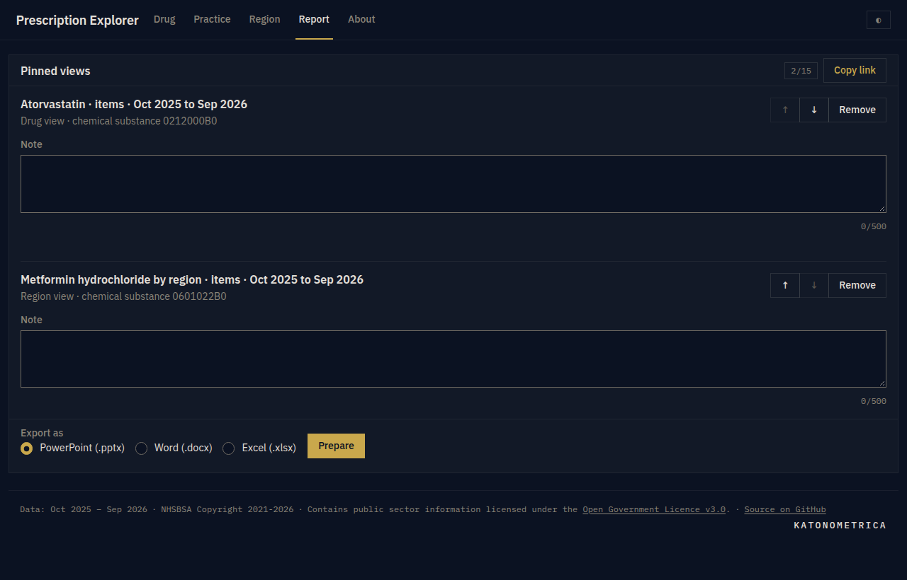

# Prescription Explorer

[](https://github.com/katonometrica/prexp/actions/workflows/ci.yaml)
[](.github/workflows/ci.yaml)


[](LICENSE.md)

Every month the NHS Business Services Authority (NHSBSA) publishes the prescriptions that NHS primary care prescribers in England issued and that were dispensed in the community: one CSV of about 18 million rows, 7.7 GB, far too big for a spreadsheet. Prescription Explorer keeps the latest twelve months in PostgreSQL. Look up a drug or a practice, compare a drug across England's regions, pin what you find to a report with notes, and export it to PowerPoint, Word or Excel.

It is a Shiny app built as an R package, and it runs in production at **[prexp.katonometrica.com](https://prexp.katonometrica.com/)**, on a small shared server, 4 CPUs and 15 GB of memory, where a scheduled task loads each new month. It was built spec-first with Claude Code, from a written specification and a plan of GitHub issues: see [How it was built](#how-it-was-built). Its code is meant to be read: [What this demonstrates](#what-this-demonstrates) maps each technique to the files that show it. Built by [Katonométrica](https://katonometrica.com).



| A drug and its presentations | A practice | A report, ready to export |
| --- | --- | --- |
|  |  |  |

## What this demonstrates

| Technique | Where |
| --- | --- |
| A Shiny app as an R package: modules (`mod_*`) for the views, plain functions (`fct_*`, `utils_*`) for the logic | [R/](R/) |
| SQL kept in files: numbered, checksummed migrations, and one file per query | [inst/sql/](inst/sql/), [R/db.R](R/db.R) |
| A query registry: the app and the plan checks run the same SQL files, with parameters, never with values pasted in | [R/fct_query_registry.R](R/fct_query_registry.R), [R/fct_queries.R](R/fct_queries.R) |
| ETL from NHSBSA's CKAN API: download, stage, aggregate beside the live data, check against staging, and swap a month in one transaction | [R/fct_source.R](R/fct_source.R), [R/fct_loader.R](R/fct_loader.R), [inst/sql/load/](inst/sql/load/) |
| Aggregated on load: a month's 18.4 million source rows become 9.5 million, one per practice and presentation, with the measures in exact `numeric` | [inst/sql/load/build_month.sql](inst/sql/load/build_month.sql) |
| A partition a month with covering indexes, and rollup tables, so a lookup reads index entries and pre-aggregated rows | [inst/sql/migrations/](inst/sql/migrations/), [inst/sql/load/swap_month.sql](inst/sql/load/swap_month.sql) |
| Every query's plan checked: it fails on a fact-table read that is not index-only, on partitions not pruned, on heap fetches, or on time, over the full twelve months and nightly in production | [R/fct_plan_check.R](R/fct_plan_check.R), [tests/testthat/test-plan-check.R](tests/testthat/test-plan-check.R) |
| A read-only login: every pooled connection is checked, and the app stops if its login can write, is a superuser, or can use the loader's schemas | [R/db.R](R/db.R) (`check_read_only()`) |
| One message for each lookup: a view's results are drawn again only when their layout changes, and each chart once, at the width the browser reports | [R/utils_view.R](R/utils_view.R), [R/mod_drug.R](R/mod_drug.R) |
| A cache shared by every session, for fetches and drawn charts, keyed on the data's window. It wraps the fetch functions instead of using `bindCache()`, so one session's passing error is never served to the others | [R/fct_cache.R](R/fct_cache.R) |
| Exports on two `mirai` workers as `ExtendedTask`s, each with its own database connection, so a 15-item PowerPoint export (about 3 s) holds up no other session | [R/fct_workers.R](R/fct_workers.R) |
| Charts with text alternatives, in the app and in the native charts of the PowerPoint, Word and Excel exports | [R/fct_charts.R](R/fct_charts.R), [R/fct_export_pptx.R](R/fct_export_pptx.R) |
| Tests on a database the real loader builds from real rows, checked against totals computed independently from the fixture files; browser flows with shinytest2 | [tests/testthat/helper-oracle.R](tests/testthat/helper-oracle.R), [tests/testthat/e2e-flows.R](tests/testthat/e2e-flows.R) |
| CI: an image tagged by the hash of the Dockerfile, `renv.lock` and the month; lint, migrations, tests, two coverage gates (85% of lines, and no function without a test) and the browser flows; then the app image published and production deployed. Actions pinned to commit SHAs | [.github/workflows/ci.yaml](.github/workflows/ci.yaml) |
| Measured performance: load times, query plans, and the 95th percentile of lookups with five users replaying recorded sessions, on the development machine and on the server | [docs/benchmarks.md](docs/benchmarks.md) |
| Production on one shared server under Coolify: a scheduled monthly load, a nightly migration and plan check, failure emails, and a deploy from CI on every merge | [docs/server.md](docs/server.md), [docs/runbook.md](docs/runbook.md) |
| The data's attribution on every page and in every PowerPoint, Word and Excel report | [R/fct_methods.R](R/fct_methods.R) |

## How it was built

1. **The specification came first.** The design was written before any code: what the app must answer, the architecture, the data model, the queries, how it is tested and how it runs, with measurable targets. It is [docs/spec.md](docs/spec.md).
2. **Then the plan, as GitHub issues.** The specification was broken down into 55 issues in [nine milestones](https://github.com/katonometrica/prexp/milestones?state=all): eight phases and a second version. Each issue gives its estimate, the issues it depends on, its tasks and its "done when" checks, and all but three documentation issues also name the section of the specification they implement. All 55, numbered #1 to #55, existed before the first pull request, #56; two bugs found along the way, [#101](https://github.com/katonometrica/prexp/issues/101) and [#115](https://github.com/katonometrica/prexp/issues/115), became issues of their own.
3. **Then every change through a pull request.** Each issue is built on its own branch and squash-merged through a pull request that names it; from P0-06, which set up CI, only once CI has passed. `main` accepts nothing else: no direct pushes, no force pushes, and no exceptions for administrators. The one commit pushed directly is the first, made before `main` was protected: the line-ending and editor settings, part of P0-01. So every commit on `main` traces back to an issue.
4. **The code, written with Claude Code.** The developer wrote the specification and the architecture. The code was written with [Claude Code](https://claude.com/claude-code), Anthropic's coding agent, one issue at a time, with each issue's tasks and checks as its brief. Its changes went through the same branches, pull requests and CI, and the work stopped at the end of each phase for the developer's review. That is why the commits name Claude as a co-author.

## How it fits together


[docs/architecture.md](docs/architecture.md) gives each decision and what it costs.

## Try it in one command

With Docker, from a clone of this repository (`git clone https://github.com/katonometrica/prexp`):

```sh
docker compose -f compose.demo.yaml up
```

The first run downloads about 0.75 GB of images. The real loader then loads a sample into PostgreSQL 18, which takes about 20 seconds; once the app's log says it is listening, open <http://localhost:3838>. There is nothing to install or configure.

- **The sample is test data, not statistics:** every row of eight real prescribers, and a sample of the prescribing NHSBSA could not attribute to a prescriber, from September 2026, plus twelve earlier months made from them with every figure scaled (the test fixtures).
- **The app's image is built for x86-64 only.** Docker Desktop on an Apple Silicon Mac runs it under emulation; on an Arm Linux machine, Docker needs amd64 emulation installed first.
- **The demo's database asks for no password** and publishes no port. With Docker Engine on Linux, though, any user of the machine can reach it while the demo runs: use a machine you do not share.
- **`docker compose -f compose.demo.yaml down -v`** removes the containers and the data. The downloaded images stay; `--rmi all` removes them too, the PostgreSQL image included, which the development stack also uses.

## Documents

- [docs/architecture.md](docs/architecture.md): each design decision and what it costs.
- [docs/spec.md](docs/spec.md): the specification the issues were written from: the data model, the queries, the tests, deployment, the work breakdown and the plans for v2.
- [docs/benchmarks.md](docs/benchmarks.md): the measurements, with how each was made.
- [docs/dataset.md](docs/dataset.md): what the loader relies on about NHSBSA's files.
- [docs/development.md](docs/development.md): the development stack, R packages, the tests and the full twelve months.
- [docs/server.md](docs/server.md) and [docs/runbook.md](docs/runbook.md): the production server, set up and operated.
- [NEWS.md](NEWS.md): what each release contains.

## Data

[English Prescribing Dataset (EPD) with SNOMED Code](https://opendata.nhsbsa.net/dataset/english-prescribing-dataset-epd-with-snomed-code), published by the NHS Business Services Authority. NHSBSA Copyright 2021-2026. Contains public sector information licensed under the [Open Government Licence v3.0](https://www.nationalarchives.gov.uk/doc/open-government-licence/version/3/).

The data has limits: it counts prescription items and quantities, not patients or diagnoses, and about a third of items have no ADQ (average daily quantity) defined, every insulin and oral anticoagulant among them, so their ADQ usage is blank. [docs/dataset.md](docs/dataset.md) has the details.

## Licence

Code: MIT, copyright [Katonométrica](https://katonometrica.com); see [LICENSE.md](LICENSE.md). Data: Open Government Licence v3.0.

The IBM Plex fonts bundled with the app are under the SIL Open Font License 1.1 ([inst/app/www/fonts/OFL.txt](inst/app/www/fonts/OFL.txt)). The KATONOMETRICA name and mark are not covered by the MIT licence.
