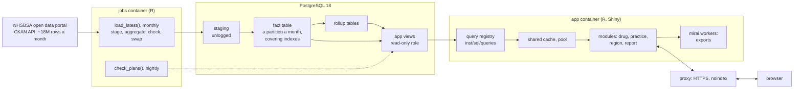

# Architecture

How Prescription Explorer is built, and why: each decision below names what it costs. The full design is in [spec.md](spec.md), and every number here comes from [benchmarks.md](benchmarks.md).

## The problem

The English Prescribing Dataset (EPD) publishes each month as one CSV of about 18 million rows, 7.7 GB, around the 20th of the second month after it. A row is a practice's prescriptions of one product in one quantity per item. The app answers questions across a rolling twelve months: a drug's national series and its presentations, a practice's top drugs, a drug compared across the regions. That is about 220 million source rows, which a lookup must not read.

## The data layer

**Aggregate on load.** The app never needs a row's product and quantity per item, so the loader sums each month to one row per practice and presentation: 9.5 million rows instead of 18.4 million, with the measures in exact `numeric`, so the load reconciles to the penny. *Cost:* the source's finest grain is not kept; a question that needs it means loading the months again.

**Rollups for the views.** The Drug and Region views read two small tables, the presentation and chemical rollups by region and month, and the Practice view's monthly totals read a third, by practice and month. The loader builds them one month at a time, so only a practice's top drugs reads the fact table. *Cost:* the loader does more work, about a third of each month's build, and every measure must be one that can be added at the rollup's grain.

**A partition a month, with covering indexes.** Each month is a partition of the fact table, with two covering indexes, so a lookup is an index-only scan over the partitions it needs, and the oldest month leaves the window by dropping a partition, not by deleting 9.5 million rows. *Cost:* an index-only scan needs the visibility map set, so the loader vacuums each new partition, and both indexes are built for every month.

**An atomic month swap.** A month is built as a table beside the live data, checked against the staged source (row counts, item and cost totals), then swapped in one transaction: the dimensions, the three rollups, the partition, the load log, and the oldest month dropped. The app sees the whole month or none of it, a failed load changes nothing, and loading a month again is how a re-published month is fixed. *Cost:* a month takes about twice its space while it loads, and the build and check take longer than a direct insert.

## The app

**SQL in files, through a registry.** Each of the app's fifteen queries is one file in `inst/sql/queries/`, read through a registry that also holds its parameters and test samples. The fetch functions and the plan check run the same files, so the SQL that is checked is the SQL the app runs, and values are always bound as parameters, never pasted into SQL. *Cost:* no R-side composition, as dbplyr offers: a new query is written, and tuned, as SQL.

**Plans checked, not assumed.** `check_plans()` runs every query with its largest and smallest samples and fails on a read that is not index-only, on partitions not pruned, on heap fetches, or on time. It runs on the full twelve months, and nightly in production, so a plan that goes wrong surfaces before a user notices. *Cost:* time limits depend on the machine (50 ms on the development machine, 150 ms on the server), and a small database can only report, since a sequential scan is the right plan there.

**A cache around the fetches and the charts, shared by every session.** A fetch another session made is answered from memory, and so is a chart it drew, keyed on the data's window, so a new month starts afresh. It wraps the fetch functions and the drawing of the charts rather than using Shiny's `bindCache()`, which would keep one session's passing error and serve it to every session. *Cost:* memory: the cache counts a chart as about 40 KB, so its 200 MB holds about 5,000, fewer with the fetches it also keeps. And a lookup no one has made yet still draws its chart, which on the server is most of its time.

**One message for each lookup.** A view's results sit in a frame that is drawn again only when its layout changes, such as another message or a chemical substance's presentations table appearing. Otherwise only the chart and table in it change. They are computed with the frame rather than once the browser reports them shown. The chart is drawn at the body's width, which the browser reports before any pick. So a lookup is one round trip, and a chart is drawn once, not again when a long table gives the page a scroll bar. *Cost:* the chart is drawn again only when the width moves by 30 px or more, and is scaled to fit until then, by up to about 3%.

**Exports in background workers.** A 15-item PowerPoint export takes about three seconds; in the app's process it would freeze every session meanwhile. Exports run on two `mirai` workers as Shiny `ExtendedTask`s, each worker with its own database connection. *Cost:* each worker holds its own memory, up to about 170 MB more after a large export, and two workers cap how many exports run at once.

**A read-only login.** The app connects as a role that can only read the app's views, and refuses to start with a login that can write or reach the loader's tables. The loader and the migrations have roles of their own. *Cost:* three passwords to manage, and a migration must grant the app what it reads.

## Quality

**Tests on real data.** The tests run against a database the real loader builds from the fixtures: every row of eight prescribers across all seven regions, and a sample of the national unidentified prescriber, from one real month, repeated as thirteen months with scaled measures, so the window's monthly drop is tested too. They compare what the app shows with totals computed independently from the fixture files. Browser flows drive the app in Chrome with shinytest2. CI fails below 85% line coverage, and also on any function no test reaches. *Cost:* the tests need PostgreSQL, so CI runs one as a service, and building the fixture database adds about 8 seconds to a run.

**One image, pinned.** CI builds its image from `docker/Dockerfile` and `renv.lock`, tagged by their hash, so the tests, the development stack and production run the same R packages; third-party actions are pinned to commit SHAs. *Cost:* a package update is a rebuild of the image.

## Running it

**One small server, rebuilt rather than backed up.** Production is the database, a `jobs` container and the app, under Coolify on a shared server with 4 CPUs and 15 GB. Everything in the database comes from the portal, so it is rebuilt, in 64 minutes, instead of backed up. A scheduled task loads each new month, a nightly one runs the migrations and the plan check, and a failure emails. *Cost:* if the database is lost, the app is down for about an hour.

**Performance, measured.** On the development machine the app's lookups answer in 224 ms at the 95th percentile with five concurrent users. On the server, whose cores are about half as fast for this work, they take 569 ms, and 957 ms for the chemical with the most presentations, measured from outside with the network included. The database's part is small at both: the time is the charts and tables built in R.
